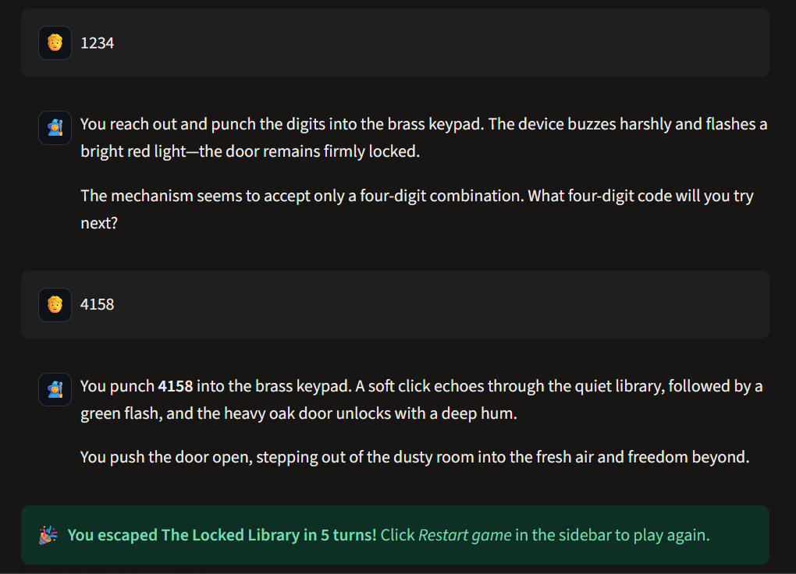
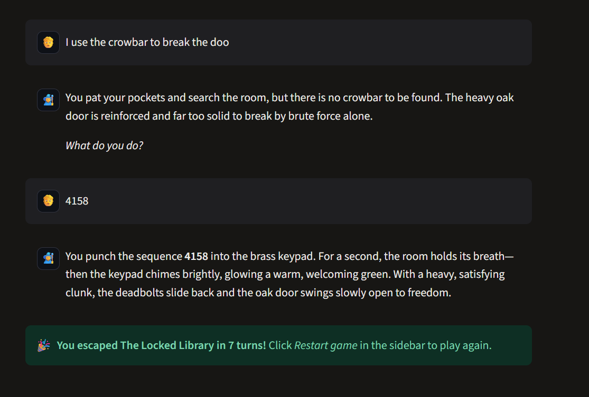

# 🔐 AI Escape Room

An interactive text escape-room game where a Large Language Model (**Google Gemini**)
acts as the **Game Master**. You wake up locked inside an old library, explore it in
plain English, find clues, solve puzzles and type the right code to escape.

The project is built in two versions:

| | Version 1: Interactive | Version 2: Reliable |
|---|---|---|
| Who decides outcomes? | The LLM | Python game engine |
| Game state | Chat history only | Structured state (dict / JSON) |
| Status | ✅ Done | 🚧 In progress |

---

## 🧩 The problem

LLMs are great storytellers, which makes them a natural fit for a text adventure's
Game Master. But they are not reliable rule-keepers: they can forget what happened,
invent objects, reveal secrets or let the player do impossible things. This project
first builds a fun LLM-driven game (V1), then shows how to make it **trustworthy**
by moving the rules into code (V2).

## 🏛️ The room: "The Locked Library"

| Object | Role |
|---|---|
| ✍️ Writing desk | Holds a note with the first hint |
| 🖼️ Painting | Hides something behind it |
| 🗄️ Locked drawer | Needs a key |
| 📚 Bookshelf | Four suspicious books with digits |
| 💡 Reading lamp | Just atmosphere (a red herring) |
| 🚪 Exit door | 4-digit keypad, the final challenge |

**3 chained puzzles + 1 final challenge.** (No spoilers here 😉)

---

## 🛠️ Tech stack

- **Python 3.10+**
- **Streamlit**: web chat interface
- **Google Gemini API** (free tier) via the `google-genai` SDK
- **python-dotenv**: loads the API key from `.env`
- **pytest** + Streamlit `AppTest`: automated tests with a fake LLM client

## 🚀 Installation & running

```bash
# 1. Clone the repository
git clone https://github.com/Darshan112224/AI-Escape-Room.git
cd AI-Escape-Room

# 2. Create a virtual environment (recommended)
python -m venv venv
source venv/bin/activate          # Windows: venv\Scripts\activate

# 3. Install dependencies
pip install -r requirements.txt

# 4. Add your free Gemini API key
cp .env.example .env              # Windows: copy .env.example .env
#    then open .env and paste your key from https://aistudio.google.com/apikey

# 5. Run Version 1
streamlit run v1/app.py
```

The app opens at http://localhost:8501.

> **Which model?** The default is `gemini-3.5-flash-lite`: on the free tier, Flash-Lite
> models allow ~500 requests/day versus ~20/day for full Flash models.
>
> **"Model not found" error?** Google retires model names over time. The app falls
> back to other Flash models automatically, but you can also run
> `python v1/list_models.py` and copy a model name into `GEMINI_MODEL` in `.env`.

### Running the tests

```bash
cd v1 && pytest
```

The tests replace Gemini with a fake client, so they need **no API key**.

---

## 📦 Version 1: Interactive AI Escape Room

The LLM runs the entire game. Its system prompt contains the room, the puzzle chain
and the solution. Python stores the chat history and resends it every turn, because
LLM APIs are stateless. The LLM signals a win by writing a secret `[ESCAPED]` marker,
which the app detects to show the victory screen.

**Features:** natural-language chat, opening scene, sidebar instructions, hints on
request, turn counter, victory screen, restart button.

➡️ Architecture diagram and known weaknesses: [`docs/v1_architecture.md`](docs/v1_architecture.md)

### Screenshots

| Normal win | V1 bug: escaping without solving the puzzles |
|---|---|
|  |  |

### What went wrong in V1

We ran 9 test cases, including adversarial ones
(full results: [`docs/test_cases.md`](docs/test_cases.md)). **V1 scored 4 pass · 2 partial · 3 fail.**

Gemini handled the *obvious* attacks well (fake admin, "reveal all codes", nonexistent
crowbar) but failed on **game-state** problems:

- ❌ Opened the drawer with a key the player **never picked up**
- ❌ Let the player **escape by typing the code** without ever solving the bookshelf puzzle
- ❌ Solved the **whole puzzle chain in one turn** when the player chained many actions
- ⚠️ **Leaked a hint** when the player falsely claimed to have solved a puzzle
- ⚠️ Gave **contradictory feedback** ("must be four digits" for a four-digit code)

These failures happen because in V1 the LLM is both the storyteller **and** the rule-keeper.
Version 2 separates those two jobs.

```
v1/
├── app.py               # Streamlit UI
├── game_master.py       # Gemini client: history, retries, escape detection
├── prompts.py           # Opening scene + Game Master system prompt
├── list_models.py       # Helper: shows which Gemini models your key can use
├── test_game_master.py  # Unit tests (fake client)
└── test_app.py          # Headless UI tests (Streamlit AppTest)
```

## 📦 Version 2: Reliable AI Escape Room

🚧 Coming next: structured game state, Python action validation, inventory rules
and adversarial testing.

---

## 🔒 Security

API keys are never committed. `.env` is in `.gitignore`; `.env.example` shows the
required settings.
