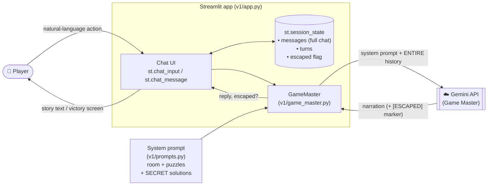

# Version 1 — Architecture

In Version 1 the **LLM is the game engine**. Python only moves messages between the
browser and Gemini; every game decision (what the player finds, whether a code is
correct, whether the player escaped) is made by the LLM.

## One turn, step by step

1. The player types an action, e.g. *"look behind the painting"*.
2. `app.py` appends it to `st.session_state.messages`.
3. `GameMaster.respond()` sends the **system prompt + the whole conversation** to Gemini.
   (The API is stateless, so the history is the game's only memory.)
4. Gemini decides what happens and writes the narration.
5. If the reply contains `[ESCAPED]`, Python marks the game as won.
6. The reply is shown and stored in the history.

## Components

| Component | File | Role |
|---|---|---|
| UI | `v1/app.py` | Chat interface, intro, instructions, restart, victory screen |
| Session state | `st.session_state` | Holds the chat history between Streamlit reruns |
| Game Master client | `v1/game_master.py` | Formats history for Gemini, retries, detects `[ESCAPED]` |
| Game design | `v1/prompts.py` | Opening scene and system prompt with room, rules and solution |
| LLM | Gemini API | Narrates **and** decides every outcome |

## Known weaknesses (motivation for Version 2)

| Weakness | Why it happens in V1 |
|---|---|
| Forgets earlier actions | The only "state" is free text; long histories get misread |
| Invents objects or items | Nothing checks the LLM's output against a real room model |
| Reveals clues too early | The solutions are inside the prompt, so the LLM knows them |
| Allows impossible actions | No code checks e.g. "does the player actually own the key?" |
| Can be talked into winning | Win = LLM writes `[ESCAPED]`, so persuasion can trigger it |
