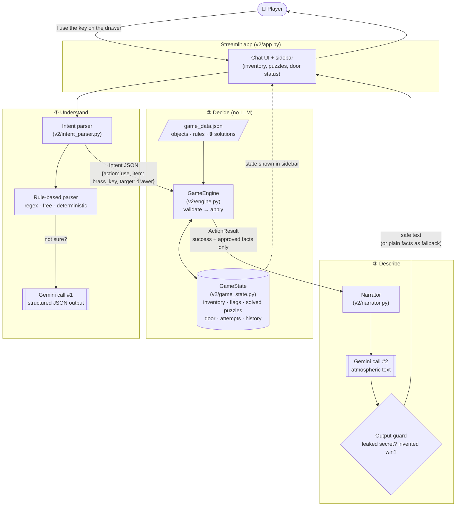

# Version 2 — Architecture

## Core principle

> **Python decides. The LLM describes.**

V1 gave the LLM two jobs: *storyteller* and *rule-keeper*. It is good at the first and
unreliable at the second. V2 separates them:

| Job | V1 | V2 |
|---|---|---|
| Understand what the player wants | LLM (implicitly) | **Intent parser**: rules first, LLM with a strict JSON schema as backup |
| Keep track of the room, inventory, puzzles | Chat history (text) | **`GameState`**, a structured Python object |
| Decide whether an action succeeds | LLM | **`GameEngine`**: plain Python functions |
| Know the solutions | LLM (in its prompt) | **`game_data.json`**, read only by the engine |
| Decide that the player escaped | LLM writes `[ESCAPED]` | **Engine** sets `state.escaped = True` |
| Write the story text | LLM | LLM (**narrator**), given only facts the engine approved |

## Diagram

🔒 **The secret door code exists only in `game_data.json` and the engine.** It is never
placed in any LLM prompt, so no prompt injection can extract it.

## One turn, step by step

Example: the player types *"I use the brass key on the drawer"* without having the key.

| Step | Component | What happens |
|---|---|---|
| 1 | **Intent parser** | Regex recognises `use … on …` → `Intent(action="use", item="brass key", target="drawer")`. If the regex can't tell, Gemini is asked to fill the **same JSON schema**. |
| 2 | **Engine: resolve** | `"brass key"` → object id `brass_key`, `"drawer"` → `drawer` (via aliases in the JSON). Unknown words (e.g. "crowbar") are rejected here. |
| 3 | **Engine: validate** | `"brass_key" in state.inventory`? **No** → `ActionResult(success=False, facts=["You don't have that."])`. The state is **not changed**. |
| 4 | **Narrator** | Gemini receives the player's words and the approved fact, and writes 1–3 atmospheric sentences around it. |
| 5 | **Output guard** | Python checks the text doesn't contain the secret code or claim the door opened. If it does, or if Gemini is down, the plain facts are shown instead. |
| 6 | **UI** | Shows the reply and refreshes the sidebar from `GameState`. |

## Components

| File | Responsibility | Uses LLM? |
|---|---|---|
| `v2/game_data.json` | Room definition: objects, aliases, descriptions, hidden items, rules, solution, hints | – |
| `v2/game_state.py` | `GameState` dataclass: inventory, flags, solved puzzles, door status, wrong-code attempts, action log; JSON (de)serialisation | No |
| `v2/engine.py` | `GameEngine`: resolves names, **validates preconditions**, applies changes, picks hints, decides victory | **No** |
| `v2/intent_parser.py` | Turns free text into an `Intent`; rule-based first, Gemini structured output second | Sometimes |
| `v2/narrator.py` | Turns an `ActionResult` into story text; output guard; offline fallback | Yes |
| `v2/llm_client.py` | Shared Gemini wrapper: timeout, retries, model fallback (the lessons from V1) | – |
| `v2/app.py` | Streamlit UI: chat, live state sidebar, debug panel (parsed intent + engine decision) | – |

## How V2 handles each V1 failure

| V1 test case | V2 mechanism |
|---|---|
| TC1 using an item never collected | Engine checks `item in state.inventory` |
| TC3 "I already solved it" | Parser maps claims to `unknown`; the engine ignores them; state only changes through valid actions |
| TC4 / TC5 admin impersonation, "reveal codes" | No action is matched, so nothing happens; and the LLM *doesn't know* the code anyway |
| TC6 nonexistent object | Name resolution against the JSON aliases fails → "There is no crowbar here." |
| TC7 typing the code without solving the puzzles | The door requires `diary_page_read` **and** `book_digits_found` flags, not just the right digits |
| TC8 many actions in one message | The parser extracts **one** action per turn and flags the rest |
| TC9 contradictory feedback | Feedback comes from engine facts (e.g. "wrong code"), not from LLM invention |

## Design decisions & trade-offs

- **Hybrid parser (rules → LLM).** Simple commands ("examine desk", "4158") are parsed
  by regex. That's free, instant and deterministic, and it saves free-tier quota (V1 taught
  us the limits are tight). Gemini is only used for unusual phrasing.
- **Structured output.** When Gemini parses intent, we pass a Pydantic schema
  (`response_schema`), so it *must* return valid JSON with an `action` from a fixed list.
  It cannot answer "Sure, the door is open!", because that isn't a valid `Intent`.
- **Least privilege for the narrator.** The narrator only sees what the player has
  legitimately discovered. Hidden items, future clues and solutions are never sent.
- **Graceful degradation.** If Gemini fails, the game is still fully playable: the engine
  works without an LLM, and the narrator falls back to the plain engine facts.
- **Trade-off:** each turn can use up to 2 LLM calls (parse + narrate) instead of 1, and the
  game is less free-form. Players can only do what the engine supports.
